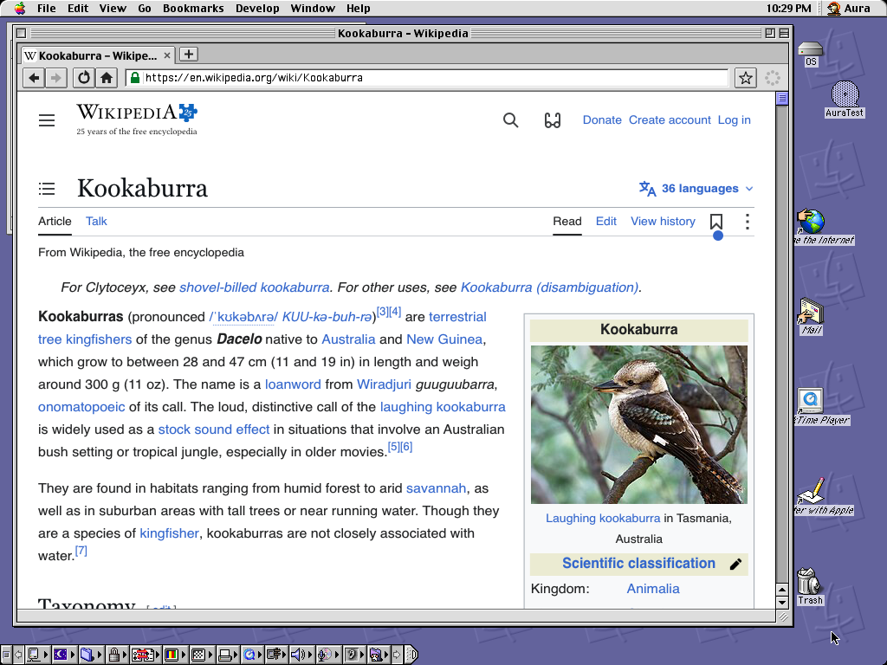

# Aura

[](https://github.com/matjam/aura/actions/workflows/ci.yml)
[](https://github.com/matjam/aura/releases)
[](LICENSE)

A web browser for Mac OS 9 on PowerPC, with its engine written from
scratch in C: HTML parser, CSS, layout, rasterizer and networking. It uses
two third-party libraries, QuickJS-ng for JavaScript and Mbed TLS for TLS.



Aura is in early development. It loads web pages over HTTP and HTTPS
(TLS 1.3 and 1.2), runs JavaScript, keeps cookies, blocks trackers with
downloaded blocklists, and downloads files. Many sites do not work yet.

## AI use disclosure

Aura was written almost entirely with AI (Anthropic's Claude), working
under my direction. I am not writing a browser engine by hand for an
operating system from 1999: that would be crazy. The HTML parser, CSS,
layout, painting, fonts, image decoders, networking and the Mac OS 9
application were all written that way, against the web standards and
Apple's old documentation, and then tested until things held up.

Does it work? It loads real sites, as the screenshot shows. Everything
here was tested with a few hundred automated test areas on a modern
machine, with fuzzers on the parsers, and in an emulator (QEMU) running
Mac OS 9.2.2. What has not happened yet:

- It has not run on a real Mac.
- It has not been used day to day for any length of time.
- Nobody has reviewed the code for security.

Every effort has been made to make Aura a secure browser: it checks
certificates, speaks TLS 1.3, treats everything a server sends as
hostile, and its parsers are fuzzed. But it is effectively vibecoded,
and it reads whatever a web server sends it on a system with no memory
protection. So you might want to do some auditing of your own before
you use it for sensitive tasks. It may eat your dog, copy your homework
or burn your house down. No warranty; see `LICENSE`.

I am fine with vibecoded, or whatever other name you like, as long as
it works and breaks nothing. If you try it on real
hardware, I would like to hear how it went, good or bad: please open an
issue. `CONTRIBUTING.md` says what is most useful to report.

## Performance

This is a browser written to use the modern web on machines that are
over 20 years old. Some things are just not going to work well.

Websites with highly unoptimized JavaScript will be slow to load and
use. Aura has web tracker blocking built in to help with that, because a
large share of slow page loads comes from third-party tracking.

That said, even well optimized sites are just heavy, so do not expect
Google Docs or Gmail to work well, if they work at all. They expect to
run on machines with 8 GB or more of RAM, not machines with 256 MB.

So your mileage may vary. We do as much as we can to optimize for
memory and CPU, but there is only so much we can do there.

## Download

Releases are on the [releases page](https://github.com/matjam/aura/releases).
Each has one self-extracting archive in two forms:

- `Aura-VERSION.hqx`, BinHex text, which survives any transfer. Decode it
  on the Mac with StuffIt Expander (part of Mac OS 9).
- `Aura-VERSION.sea.bin`, MacBinary, for tools that keep resource forks.

Either gives the application "Aura VERSION Installer". Open it on Mac OS
9.1 to 9.2.2 and choose where the Aura folder goes. The folder holds
Aura, its fonts, the root certificates and the licences (Aura's own is
MIT, in `Licences`). The build of every
commit is attached to its
[CI run](https://github.com/matjam/aura/actions/workflows/ci.yml) in the
same two forms.

## Build

To build and test on the development machine, then build the Mac OS 9
application, run:

```bash
./build.sh
```

The Mac OS 9 build needs Retro68's PowerPC toolchain. To install it in
`~/.local/opt/retro68`, run `toolchain/build.sh`. To use one you already
have, set `RETRO68` to its folder.

The build leaves the application in `build/ppc/dist/Aura`, beside a
`Fonts` folder, a `Licences` folder and `aura-roots`, the certificate
authorities HTTPS trusts (Mozilla's root set), and packs that folder as
`build/ppc/dist/Aura-VERSION.hqx` and `Aura-VERSION.sea.bin`. Keep the
folder's files together; without `aura-roots` no HTTPS site loads. Aura needs Open Transport with TCP/IP
configured. In the fonts folder: Aura draws pages with your
system's fonts first and uses these open source fonts (Liberation-based
Aura Sans, Serif and Mono, Inter, DejaVu Sans, Noto Emoji and the colour
emoji font Twemoji Mozilla) for families and characters the system lacks.
Each font's licence is in its folder; `assets/fonts/README.md` lists their
sources. Pages can also bring their own fonts with `@font-face` (WOFF2,
WOFF or TrueType, variable fonts included).

## Licence

Aura's own code is under the MIT licence; see `LICENSE`. QuickJS-ng,
Mbed TLS (Apache-2.0), the bundled fonts, the root certificates and the Public Suffix
List keep their own licences: see `third_party/README.md`,
`assets/fonts/README.md` and Aura's About box.
